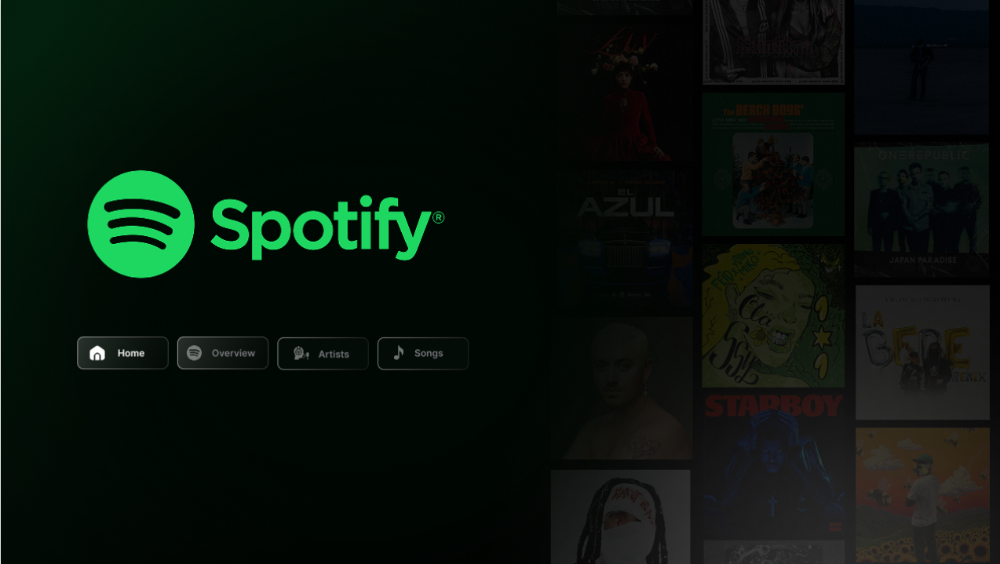
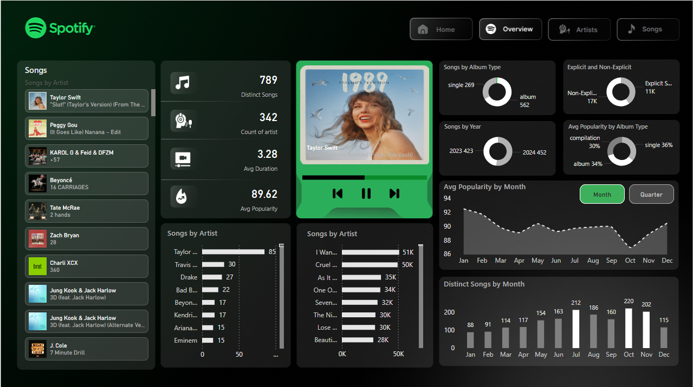
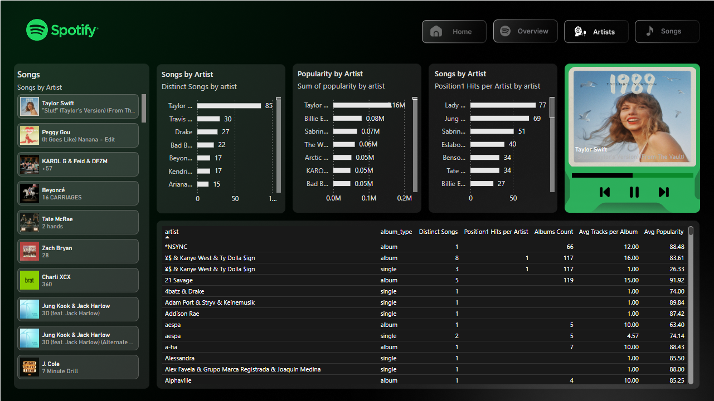
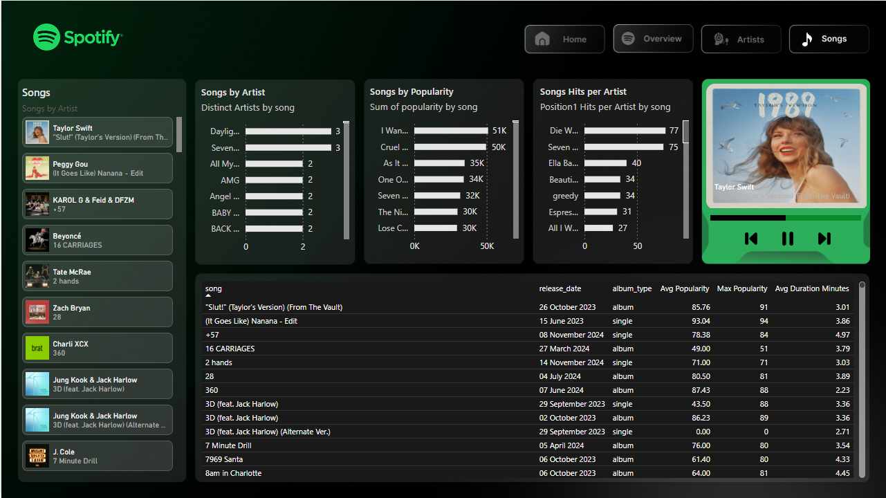

# Spotify Data Analytics Project

## 📌 Project Overview

This project presents an **end-to-end data analytics pipeline** on Spotify Top 50 songs data.
It combines **SQL, Python (EDA), and Power BI** to extract meaningful insights about music trends, artist performance, and song characteristics.

The goal of this project is to demonstrate  **real-world data analytics skills** , including data cleaning, exploration, visualization, and business insight generation.

---

## 🎯 Objectives

* Analyze factors influencing song popularity
* Identify trends in music consumption over time
* Understand artist dominance and consistency
* Explore lifecycle patterns of hit songs
* Segment songs using machine learning techniques

---

## 🛠️ Tech Stack

* **Python** : Pandas, NumPy, Matplotlib, Seaborn, Scikit-learn
* **SQL** : Data querying and transformation
* **Power BI** : Interactive dashboard creation

---

## 📂 Project Structure

```
Spotify-Data-Analytics-Project/
│
├── data/
│   ├── raw/
│   ├── cleaned/
│
├── notebook/
│   └── spotify_eda.ipynb
│
├── sql/
│   └── analysis_queries.sql
│
├── dashboard/
│   ├── spotify_dashboard.pbix
│   ├── spotify_dashboard.pdf
│
├── visuals/
│
├── README.md
├── requirements.txt
└── .gitignore
```

---

## 🔄 Project Pipeline

```
SQL → Data Cleaning → Python EDA → Power BI Dashboard
```

---

## 📊 Exploratory Data Analysis (Python)

Performed advanced EDA including:

* Data cleaning & preprocessing
* Feature engineering (song age, duration, time features)
* Distribution analysis
* Correlation analysis
* Time series analysis
* Artist-level insights
* Song lifecycle analysis
* Explicit content analysis
* Clustering using K-Means

---

## 📈 Power BI Dashboard

The project includes a **3-page interactive dashboard** covering:

* Song popularity trends
* Artist performance analysis
* Song characteristics insights

 A PDF version of the dashboard is included for quick preview.


---

## 📷 Dashboard Preview

Dashboard page 1.



Dashboard page 2

Dashboard page 3



Dashboard page 4



---

## 📊 Key Insights

* Most songs in Top 50 maintain high popularity, indicating intense competition
* Shorter songs tend to perform slightly better (higher engagement potential)
* New releases dominate charts, highlighting recency bias in music trends
* A small group of artists consistently dominate rankings
* Explicit content is highly competitive in modern music trends
* Songs exhibit different lifecycle patterns: viral hits vs long-term performers
* Clustering reveals distinct groups of songs based on performance and characteristics

---

## 🚀 Business Insights

* Artists should focus on **frequent releases** to stay relevant
* **Shorter duration songs** may improve replayability and engagement
* Building a **strong personal brand** helps artists consistently dominate charts
* Early traction is critical for achieving viral success

---

## 🧠 Skills Demonstrated

* Data Cleaning & Preprocessing
* Exploratory Data Analysis (EDA)
* SQL Querying & Optimization
* Data Visualization (Python & Power BI)
* Feature Engineering
* Machine Learning (Clustering)
* Analytical Thinking & Business Insights

---

## ⚙️ How to Run This Project

1. Clone the repository:

```
git clone https://github.com/your-username/spotify-data-analytics.git
```

2. Install dependencies:

```
pip install -r requirements.txt
```

3. Run the Jupyter Notebook:

```
jupyter notebook
```

---

## 📌 Future Improvements

* Add predictive modeling for song popularity
* Deploy dashboard as a web application
* Integrate real-time Spotify API data

---

## 🙌 Acknowledgment

This project is created as part of a  **portfolio to demonstrate end-to-end data analytics skills** .

---

## ⭐ If you found this useful

Feel free to ⭐ the repository and connect with me!
